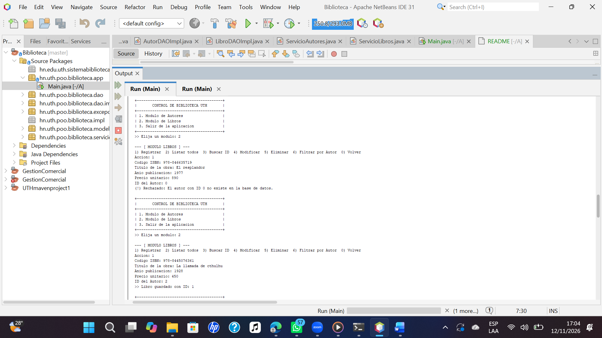
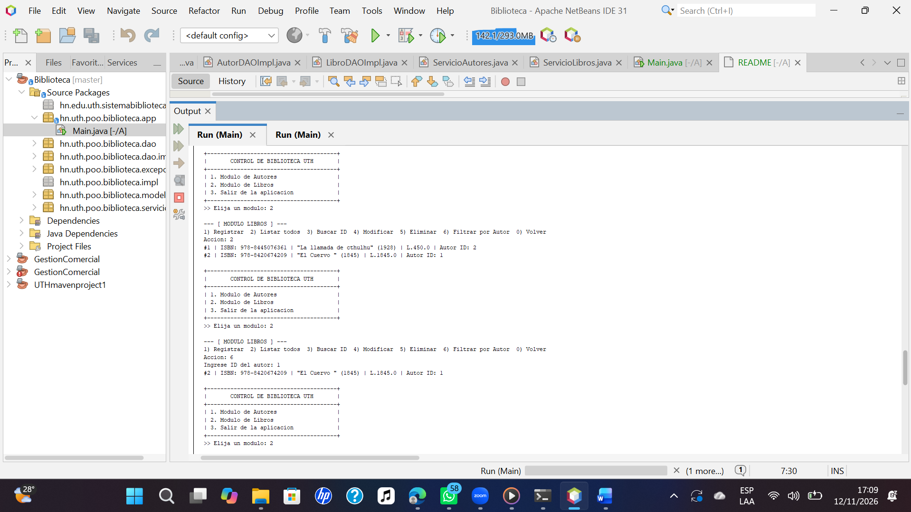
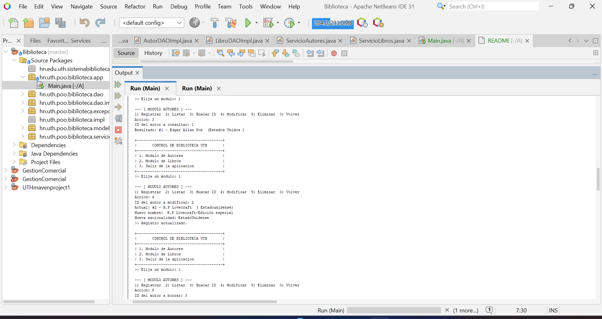

# Control de Biblioteca - Segundo Parcial POO

**Universidad:** Universidad Tecnológica de Honduras (UTH)  
**Alumno:** Danny Josue Murillo Urrea  
**Cuenta:** 202530040113  

## Arquitectura y Tecnologías
Sistema de consola en Java estructurado en capas (`modelo`, `excepciones`, `dao`, `dao.impl`, `servicio`, `app`) conectado a una base de datos relacional **SQLite** mediante el driver **JDBC**. Utiliza sentencias `PreparedStatement`, cierre automático con `try-with-resources` y validación de integridad referencial (`PRAGMA foreign_keys = ON`).

## Pasos de Ejecución
1. Descargar o clonar el repositorio:
   `git clone https://github.com/21danm/SistemaBiblioteca.git`
2. Importar el proyecto Maven en **Apache NetBeans**.
3. Ejecutar **Clean and Build** para resolver las dependencias del archivo `pom.xml`.
4. Iniciar la clase `hn.uth.poo.biblioteca.app.Main`.

## Evidencias de Funcionamiento

### Módulo de Autores
* **Registro y Listado de Autores:**  
  

* **Consulta por ID, Modificación y Eliminación de Autor:**  
  

### Módulo de Libros
* **Registro, Listado General y Filtro por Autor:**  
  

* **Consulta por ID, Modificación y Eliminación de Libro:**  
  

### Pruebas de Reglas de Negocio (Excepciones)
* **Rechazo por código ISBN duplicado:**  
  

* **Rechazo al intentar borrar un autor con libros asociados:**  
  